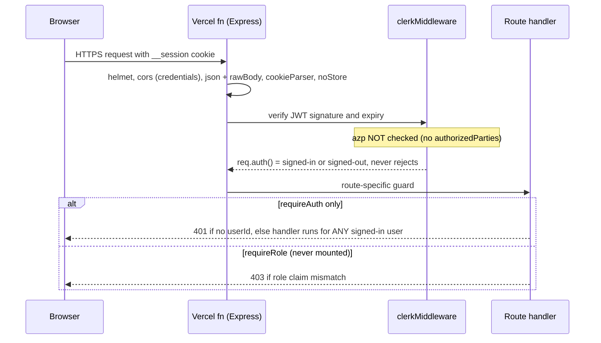
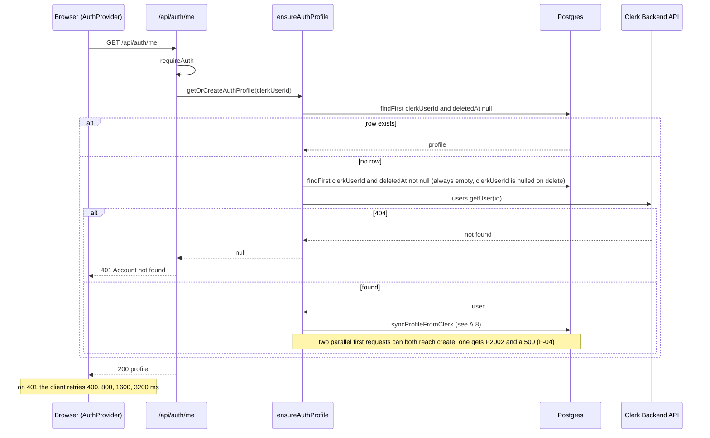
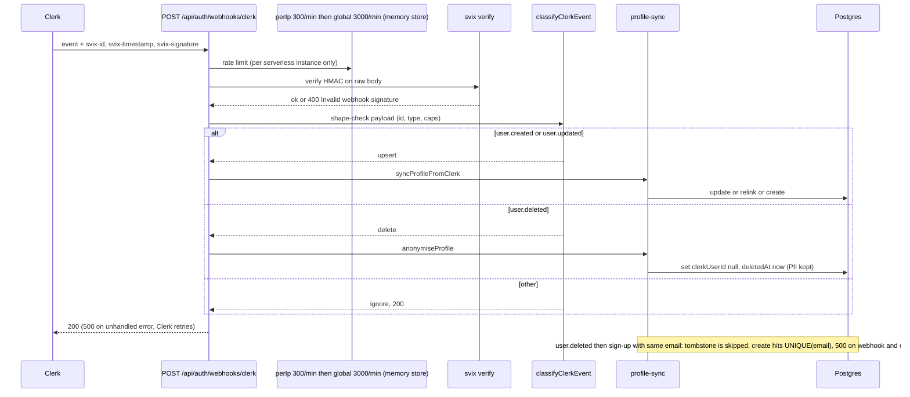
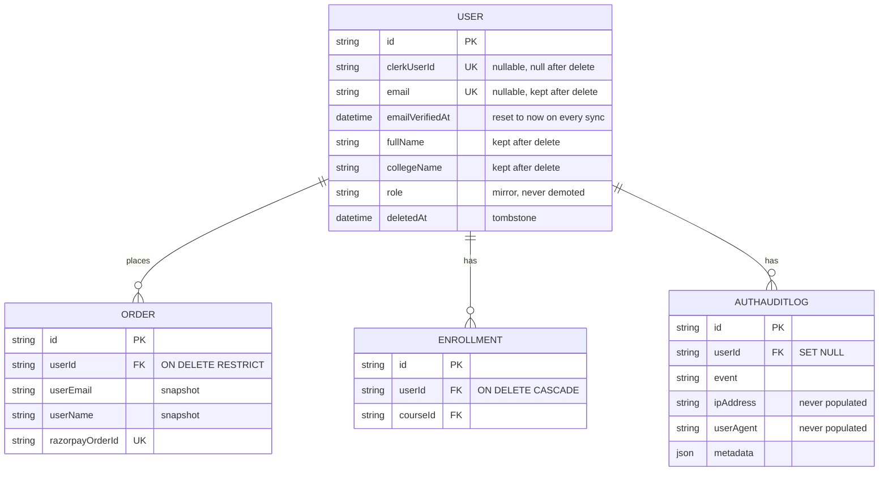
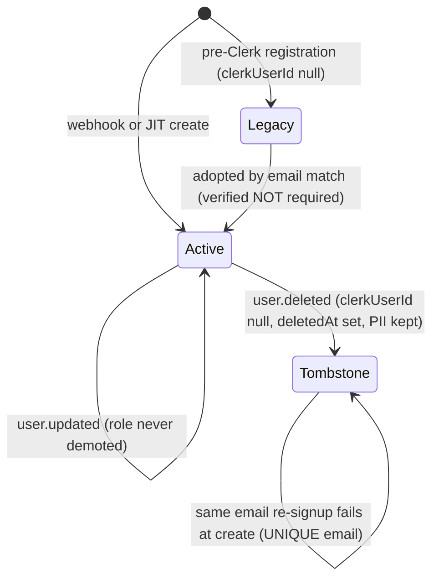
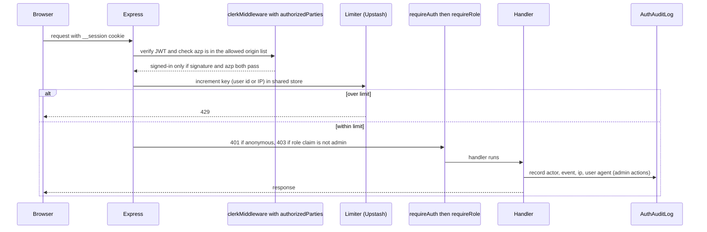
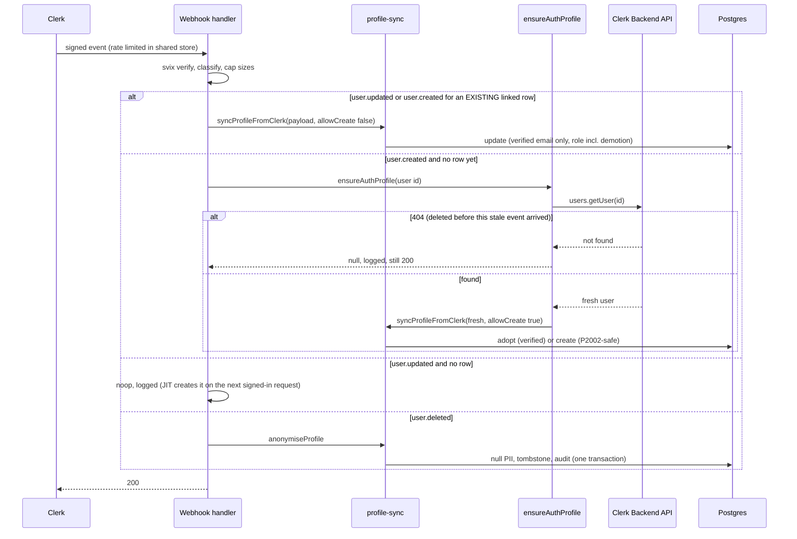
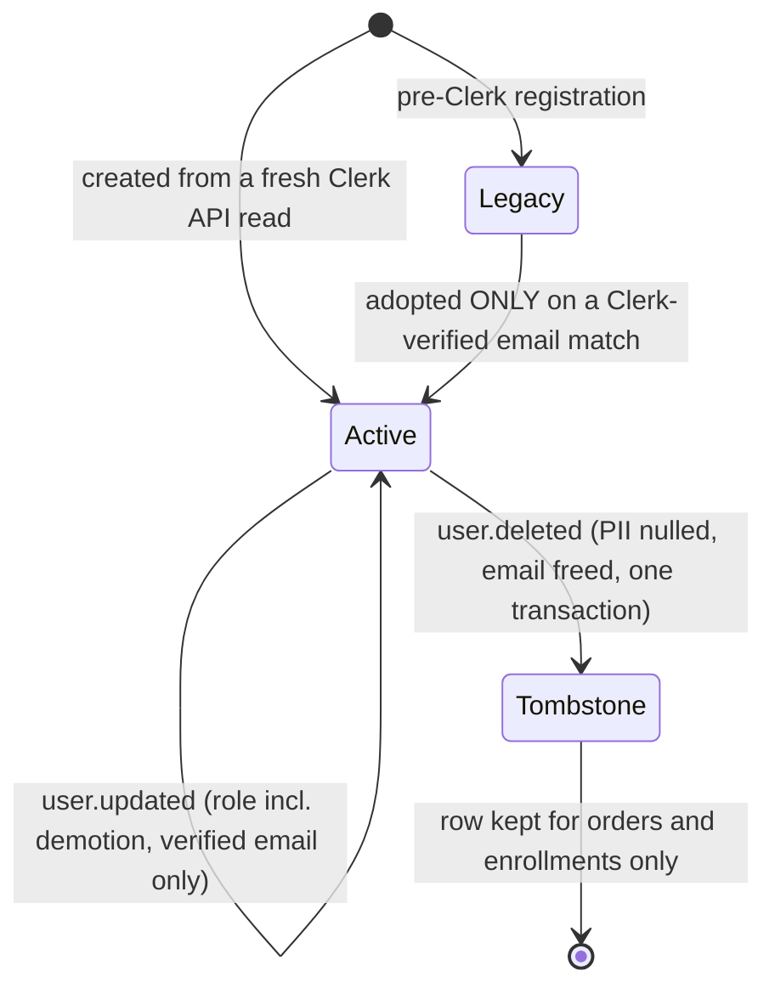

# Auth Redesign: Current vs Target (HLD + LLD) and Phased Implementation Plan

**Repo:** `github.com/Yash7256/Sedative-Physio-Blog` (Vite/React client, Express + Prisma server, Clerk auth, Vercel deploy)
**Source of truth for findings:** the end-to-end auth audit (IDs `F-01` … `F-13` are used throughout).
**Audience:** a coding agent (Codex) executing the plan, and the human who reviews each PR.

> **Status.** Parts A and B are **historical design context** from the earlier Codex plan. The current source of truth is `implmentation/OPENCODE_IMPLEMENTATION_PLAN.md`; Part C and the appendices below are superseded wherever they conflict with it.

> **Reading order.** Part A = how auth worked at the time of the audit (HLD, then LLD) with defects marked.
> Part B = the target design proposed at that time (HLD, then LLD).
> Part C and the appendices = the superseded plan, kept for traceability.

---

## 0. How Codex must use this document

### 0.1 Ground rules (non-negotiable)

1. **One phase = one branch = one PR.** Branch names: `auth/p1-harness`, `auth/p2-authz`, … Never mix phases.
2. **Tests first.** For every behavior change: write the test, run it, see it fail for the right reason, then implement, then see it pass. Paste the red and green output in the PR description.
3. **Keep Clerk.** Do not add another auth library, do not reintroduce passwords, JWT signing, refresh tokens, or session tables. Clerk owns identity.
4. **Fail closed.** Missing env var, missing claim, unknown role, store error on an admin route: deny.
5. **Never print or log secrets or PII.** No env values in logs, test output, or PR text. Names of variables are fine.
6. **Do not touch:** `server/generated/**` (committed Prisma client), Razorpay payment logic (`server/src/payments/**`) except where a phase says so, client UI except where a phase says so.
7. **No schema migration is required by this plan.** If you believe one is needed, stop and ask (see 0.3).
8. **Every phase ends green:** `npm --prefix server run typecheck`, `npm --prefix server run lint`, `npm --prefix server test`, and (if client touched) `npm --prefix client test`.
9. **Smallest diff that satisfies the acceptance criteria.** No drive-by refactors, no renames of public exports unless listed.

### 0.2 Environment notes

- Node >= 20. Install with `npm ci --ignore-scripts` in `server/` (and `client/`) if the `postinstall` (`prisma generate`) cannot reach the network. The Prisma client is already committed under `server/generated`.
- Establish a baseline **before any change**: run the full server and client suites and record the counts in the first PR. (The auth, clerk and payments-user-id subsets were 96 passing tests at audit time.)
- There is no database in the sandbox. Unit tests mock `../lib/prisma.js` at the module boundary (see `server/src/auth/__tests__/profile-sync.unit.test.ts` for the pattern). Do not add a DB dependency to tests.
- Route-level tests use Node's `http` + `fetch` with a fake `req.auth` function (see `server/src/__audit_poc__/audit-poc.unit.test.ts`, shipped alongside this doc). Do not add `supertest` unless asked.

### 0.3 Stop-and-ask conditions

Stop and ask the human instead of guessing when:
- a task would need a DB migration, a new paid service, or a new top-level dependency not named in this plan;
- an acceptance criterion cannot be met without weakening another;
- real Clerk keys or a live database are needed to verify something (mark it `MANUAL` in the PR and move on);
- a phase's tests reveal a defect not in this plan (report it; do not silently fix unrelated code).

### 0.4 Task legend

| Tag | Meaning |
|---|---|
| `CODE` | Codex does this |
| `HUMAN` | Only the repo owner can do this (dashboards, key rotation, history rewrite). Codex writes the checklist into the PR and does **not** attempt it |
| `MANUAL` | Verified by a person against a real environment after deploy |

---

# PART A: CURRENT STATE

## A.1 HLD: system context

```
                        ┌──────────────────────────────────────────────┐
                        │                   CLERK (SaaS)                │
                        │ credentials · sessions · OAuth · email verify │
                        │ publicMetadata.role · Backend API · svix      │
                        └───────▲───────────────▲───────────────┬──────┘
          sign-in / sign-up UI  │               │ Backend API    │ svix-signed webhooks
          (ClerkProvider)       │               │ (secret key)   │ user.created/updated/deleted
                                │               │                ▼
 ┌─────────────┐   __session cookie   ┌──────────┴────────────────────────────────────┐
 │  Browser    │──(credentials:include)─▶│  Vercel serverless function  api/index.ts     │
 │ React SPA   │◀────────JSON───────────│  Express app  server/src/app.ts               │
 │ (client/)   │                        │                                                │
 └─────────────┘                        │  helmet → cors → json(+rawBody) → cookieParser │
                                        │  → noStore → /api/health                       │
                                        │  → clerkMiddleware()  (verifies, never rejects)│
                                        │  → routers: auth · notes · models · courses    │
                                        │             contact · payments · images        │
                                        └───────┬───────────────┬──────────────┬─────────┘
                                                │               │              │
                                  ┌─────────────▼───┐   ┌───────▼──────┐  ┌────▼─────────────┐
                                  │ Postgres (Prisma)│   │ GitHub API   │  │ Razorpay · R2 ·  │
                                  │ User, Order,     │   │ PAT = write  │  │ SMTP · remote    │
                                  │ Enrollment,      │   │ to repo main │  │ image hosts      │
                                  │ AuthAuditLog …   │   │ (models/*.glb)│ └──────────────────┘
                                  └──────────────────┘   └──────────────┘
```

**Key facts about today's design**

- Identity (credentials, sessions, verification) is fully delegated to Clerk. The API has **no** login, register, refresh or reset endpoints.
- The browser authenticates with **Clerk's `__session` cookie only**. The client never sends `Authorization: Bearer`.
- `clerkMiddleware()` runs for every request after `/api/health`; it attaches `req.auth` and **never rejects**. Rejection is each route's job (`requireAuth`, `requireRole`, or an inline check).
- A local `User` row (domain profile) is joined to Clerk by `clerkUserId`. It is created three ways: Clerk webhook, just-in-time (JIT) provisioning from the Clerk Backend API on first `/me` or payment call, or **adoption** of a pre-Clerk row by email.
- Authorization intent: roles come from Clerk `publicMetadata.role` via **session claims** (`sessionClaims.metadata.role`), not the DB mirror.

## A.2 HLD: components and responsibilities

| Component | Location | Responsibility today | Defects |
|---|---|---|---|
| Clerk session verification | `app.ts:70` `clerkMiddleware()` | Verify JWT from cookie/header, attach `req.auth()` | No `authorizedParties` (F-07) |
| Auth helpers | `lib/clerk.ts` | `readAuth`, `readAuthUserId`, `getClerkClient` | none |
| `requireAuth` | `auth/middleware/require-auth.ts` | 401 if no `userId` | none |
| `requireRole` | `auth/middleware/require-role.ts` | 401/403 from `sessionClaims.metadata.role` | **Unused anywhere** (F-01) |
| Profile API | `auth/routes/me.ts` | `GET/PATCH /api/auth/me` | No rate limit on Clerk-backed calls (F-08) |
| Clerk webhook | `auth/webhook.ts`, `services/webhook-verify.ts` | svix verify, normalise, dispatch | In-memory limiters (F-08) |
| Profile sync | `services/profile-sync.ts` | create / relink / sync / anonymise | F-02, F-04, F-05, F-06, F-10 |
| JIT provisioning | `services/provision.ts` | create row from Clerk API if missing | dead tombstone check; shares sync defects |
| Local id resolution | `services/me.ts` `resolveLocalUserId` | Clerk id → local `User.id` | none |
| Audit | `services/audit.ts`, `context.ts` | meant to record events with ip/ua | **No callers** (F-09) |
| Models router | `models/router.ts`, `service.ts`, `github.ts` | list public; upload/sync/delete via GitHub PAT | **`requireAuth` only** (F-01) |
| Image proxy | `images/router.ts` | fetch any URL → WebP | **Unauthenticated SSRF** (F-12) |
| Rate limiters | `payments`, `contact`, `webhook` routers | `express-rate-limit`, default memory store | Per-instance on serverless (F-08) |
| Client auth | `client/src/lib/auth.tsx`, `api.ts`, `RequireAuth.tsx` | Clerk React + `/me` profile fetch, cookie credentials | none (UI guard only; server enforces) |

## A.3 HLD: trust boundaries and secrets

| # | Boundary | Credential | Today's control |
|---|---|---|---|
| 1 | Browser → API | `__session` cookie (JWT) | `clerkMiddleware()` signature check; **no azp check** |
| 2 | Clerk → API (webhook) | svix signature (`CLERK_WEBHOOK_SECRET`) | svix verify on raw body; fail-closed if secret missing |
| 3 | API → Clerk Backend API | `CLERK_SECRET_KEY` | server-only; used by JIT and `PATCH /me` |
| 4 | API → GitHub | `GITHUB_TOKEN` (PAT) | **Writes to `main` of the app repo per `.env.example`; reachable by any signed-in user** |
| 5 | Razorpay → API | HMAC `RAZORPAY_WEBHOOK_SECRET` | timing-safe compare |
| 6 | Anonymous → API | none | rate limits (memory), caching headers |

Secrets exposed in git history (not in code): old Supabase service-role key, Vercel OIDC token, Grok key (F-03).

## A.4 HLD: authorization matrix (current)

| Route | Method | AuthN | AuthZ | Rate limit | Defect |
|---|---|---|---|---|---|
| `/api/health` | GET | none | none | none | |
| `/api/auth/me` | GET | `requireAuth` | self | none | JIT hits Clerk API per call (F-08) |
| `/api/auth/me` | PATCH | `requireAuth` | self (name, college) | none | Clerk-API amplification (F-08) |
| `/api/auth/webhooks/clerk` | POST | svix signature | n/a | 300/min/IP + 3000/min global (memory) | per-instance (F-08) |
| `/api/notes`, `/:id/download`, `/:id/file` | GET | none | `isPublished` only | none | by design: free notes |
| `/api/courses`, `/:slug` | GET | none | `isPublished` | none | metadata only, OK |
| `/api/models` | GET | none | none | CDN cache | |
| **`/api/models/upload`** | POST | `requireAuth` | **none (any user)** | none | **F-01** |
| **`/api/models/sync`** | POST | `requireAuth` | **none (any user)** | none | **F-01** |
| **`/api/models/:id`** | DELETE | `requireAuth` | **none (any user)** | none | **F-01** |
| **`/api/images?src=`** | GET | none | none | none | **F-12 SSRF** |
| `/api/contact` | POST | none | none | 10/h IP, 5/h email (memory) | F-08 |
| `/api/payments/config` | GET | none | none | none | |
| `/api/payments/my-enrollments`, `/my-orders` | GET | optional | self, `[]` if anon | none | |
| `/api/payments/create-order` | POST | `resolveLocalUserId` → 401 | self | 10/15 min (memory) | F-08 |
| `/api/payments/verify` | POST | same | order owner | 20/15 min (memory) | F-08 |
| `/api/payments/free-enroll` | POST | same | self | 20/15 min (memory) | F-08 |
| `/api/payments/webhook` | POST | Razorpay HMAC | n/a | none | |

## A.5 LLD: module map (current)

```
server/src/
  app.ts                      createApp(): middleware order, router mounts
  index.ts                    local listen (Vercel uses api/index.ts default export)
  lib/
    clerk.ts                  readAuth(req) · readAuthUserId(req) · getClerkClient()
    errors.ts                 HttpError classes · handleError(err,res)
    prisma.ts                 PrismaClient singleton (adapter-pg)
    cache.ts                  noStore() default · cacheControl() opt-in
  auth/
    constants.ts              FULL_NAME_MAX_LENGTH · COLLEGE_NAME_MAX_LENGTH · AUDIT_EVENT{PROFILE_CREATED,RELINKED,ANONYMISED}
    context.ts                requestContext(req) -> {ipAddress,userAgent}        (NO CALLERS)
    types.ts                  RequestContext
    router.ts                 /me  ·  /webhooks/clerk
    middleware/
      require-auth.ts         requireAuth: 401 if !userId
      require-role.ts         requireRole(role): 401/403 from sessionClaims.metadata.role   (NO CALLERS)
    routes/me.ts              GET /  ·  PATCH /
    services/
      me.ts                   getAuthProfile · getOrCreateAuthProfile · resolveLocalUserId
      provision.ts            ensureAuthProfile · readClerkUser · toSyncData
      profile-sync.ts         syncProfileFromClerk · anonymiseProfile · findAdoptableRow · applyClerkFields · recordProfileEvent
      profile-update.ts       updateAuthProfile (Clerk first, then DB)
      webhook-verify.ts       verifyClerkEvent · classifyClerkEvent · readPrimaryEmail · readRole · readFallbackName
      audit.ts                recordAuditEvent                                       (NO CALLERS)
    webhook.ts                POST /webhooks/clerk · createDeliveryLimiters
  models/{router,service,github}.ts      upload/sync/delete via GitHub contents API
  images/router.ts                       GET /?src=
  payments/{router,service}.ts           optional-auth routes · Razorpay
  contact/{router,service}.ts
```

## A.6 LLD: request pipeline (current)



## A.7 LLD: first sign-in and `GET /api/auth/me` (JIT provisioning)



## A.8 LLD: `syncProfileFromClerk` (current algorithm)

```
syncProfileFromClerk(user):
  existing = User.findFirst({ clerkUserId: user.id })
  if existing:
      applyClerkFields(existing)                         # email, emailVerifiedAt=now() if verified,
      return synced                                      # fullName only if null, role only if present  (F-06, F-10)
  {email, emailVerifiedAt} = readPrimaryEmail(user)      # falls back to addresses[0], verified or NOT
  candidate = email ? User.findFirst({ email, clerkUserId: null, deletedAt: null }) : null
  if candidate:                                          # NO verified check                             (F-02)
      applyClerkFields(candidate, adoptClerkId=true)     # legacy orders + enrollments now belong to this Clerk user
      audit(PROFILE_RELINKED)
      return relinked
  User.create({ clerkUserId, email, emailVerifiedAt, fullName, role: role ?? "user" })
                                                         # no P2002 handling: UNIQUE(email) after delete,
                                                         # or two concurrent creators                    (F-04)
  audit(PROFILE_CREATED)

applyClerkFields(...):
  update({ email, emailVerifiedAt, fullName?(if null), ...(role ? {role} : {}) })   # never demotes (F-06)
  catch P2002 -> return silently                         # also swallows an email collision, undiagnosable

anonymiseProfile(clerkUserId):
  update({ clerkUserId: null, deletedAt: now() })        # email, fullName, collegeName stay        (F-04, F-05)
  audit(PROFILE_ANONYMISED)                              # clerkUserId metadata lost (id already nulled)
```

## A.9 LLD: webhook and deletion flows (current)



## A.10 LLD: data model (auth-relevant slice, current)



## A.11 LLD: `User` row lifecycle (current)



## A.12 Defect overlay (where each finding lives)

| ID | Sev | Diagram / algorithm | Exact location |
|---|---|---|---|
| F-01 | Critical | A.4 matrix, A.6 pipeline | `models/router.ts:33,65,75` (`requireAuth` only) |
| F-02 | High | A.8 relink branch | `profile-sync.ts:45-54, 110-117`; `webhook-verify.ts:265-288` |
| F-03 | High | A.3 boundary 4/3 | git history `cbd5af03`, `c2cca441` |
| F-04 | Med | A.8 create, A.9, A.11 | `profile-sync.ts:56`; `schema.prisma` `User.email @unique` |
| F-05 | Med | A.8 anonymise, A.10 | `profile-sync.ts:90-93` |
| F-06 | Med | A.8 applyClerkFields | `profile-sync.ts:147` |
| F-07 | Med | A.6 pipeline | `app.ts:70` |
| F-08 | Med | A.4, A.9 | all `rateLimit(` call sites, default memory store |
| F-09 | Low | A.5 | `services/audit.ts`, `context.ts` unused |
| F-10 | Low | A.8, A.10 | `webhook-verify.ts:285` (`new Date()` each sync) |
| F-11 | Low | n/a | `npm audit`: 13 issues; unused `argon2`, `jose` in root `package.json` |
| F-12 | Low* | A.4 matrix | `images/router.ts` (*adjacent to auth, but unauthenticated and reachable by anyone) |
| F-13 | Low | n/a | no tests for `requireAuth`, `requireRole`, `/me`, models router |
| (new) | Med | A.8 | **Unverified email squatting:** an unverified address is stored in the `UNIQUE` email column, so an attacker's unverified claim to `victim@x.com` makes the real owner's later sync fail with P2002. Found while designing the target state; fixed by invariant I2 below |

---

# PART B: TARGET STATE

## B.1 Design invariants (each one is a test)

| # | Invariant | Closes |
|---|---|---|
| I1 | Every route that mutates shared/global state requires `requireAuth` **and** an explicit role. Admin routes are mounted through one `requireAdmin` guard, so a new admin route cannot be added "auth only" by accident | F-01 |
| I2 | `User.email` only ever holds a **Clerk-verified** address. Unverified addresses are stored as `null`. A legacy row is adopted only on a verified match | F-02, squatting |
| I3 | The local `User.role` always equals Clerk `publicMetadata.role` (or `"user"` if absent). Demotion propagates. Role changes are audit-logged | F-06 |
| I4 | Deleting a Clerk user removes the profile's PII (`email`, `fullName`, `collegeName`), keeps the row for order/enrollment history, and frees the email for reuse | F-04, F-05 |
| I5 | A profile row is **created only from a fresh Clerk Backend API read**, never from a webhook payload, so a stale or out-of-order event can never create a row for a deleted user. Creation is race-safe (P2002 is handled) | F-04 |
| I6 | The API accepts a session only if its `azp` is one of the configured origins | F-07 |
| I7 | Rate limits are enforced against a **shared** store; production refuses to boot on a per-instance store unless explicitly overridden | F-08 |
| I8 | Security-relevant actions (profile create/relink/anonymise, role change, model upload/delete/sync) write an `AuthAuditLog` row with actor, IP and user agent | F-09 |
| I9 | Anonymous input can never make the server fetch a private-network address, and can only fetch from an allowlist | F-12 |
| I10 | `emailVerifiedAt` records the first time the address was seen verified, not the last sync | F-10 |

## B.2 HLD: system context (target)

```
                        ┌──────────────────────────────────────────────┐
                        │                   CLERK (SaaS)                │
                        │ dashboard: verified-email required · role in  │
                        │ publicMetadata · session token carries        │
                        │ "metadata" claim · MFA for admins             │
                        └───────▲───────────────▲───────────────┬──────┘
                                │               │ Backend API    │ svix webhooks
                                │               │ (read-before-  │ (sync EXISTING rows only;
                                │               │  create)       │  creation = API read)
 ┌─────────────┐   __session cookie    ┌────────┴────────────────▼────────────────────┐
 │  Browser    │────────────────────────▶│ Vercel fn → Express (server/src/app.ts)       │
 │ React SPA   │◀──────JSON─────────────│ helmet → cors → json(+rawBody) → noStore       │
 └─────────────┘                         │ → clerkMiddleware({ authorizedParties })  [I6] │
                                         │ → shared-store rate limiters              [I7] │
                                         │ → routers                                      │
                                         │    admin routes: requireAuth+requireRole  [I1] │
                                         │    all admin actions → AuthAuditLog       [I8] │
                                         └──┬───────────┬───────────┬───────────┬─────────┘
                                            │           │           │           │
                              ┌─────────────▼──┐ ┌──────▼─────┐ ┌───▼────────┐ ┌▼──────────────────┐
                              │ Postgres        │ │ Upstash    │ │ GitHub     │ │ Image hosts       │
                              │ (no migration)  │ │ Redis REST │ │ DEDICATED  │ │ allowlist only    │
                              │                 │ │ rate limits│ │ assets repo│ │ + private-IP block│
                              └─────────────────┘ └────────────┘ │ fine-grained│ └───────────────────┘
                                                                 │ PAT         │
                                                                 └─────────────┘
 CI (GitHub Actions): typecheck · lint · test · npm audit --audit-level=high · gitleaks
```

## B.3 HLD: authorization matrix (target, changed rows only)

| Route | Method | AuthN | AuthZ | Rate limit (shared store) |
|---|---|---|---|---|
| `/api/auth/me` | GET | `requireAuth` | self | 60/min/user |
| `/api/auth/me` | PATCH | `requireAuth` | self | 10/min/user |
| `/api/auth/webhooks/clerk` | POST | svix signature | n/a | 300/min/IP + global ceiling (now actually shared) |
| `/api/models/upload` | POST | `requireAuth` | **role `admin`** | 10/hour/user, **fail-closed** on store error |
| `/api/models/sync` | POST | `requireAuth` | **role `admin`** | 10/hour/user, fail-closed |
| `/api/models/:id` | DELETE | `requireAuth` | **role `admin`** | 30/hour/user, fail-closed |
| `/api/images?src=` | GET | none | **host allowlist + private-IP block** | 120/min/IP |
| `/api/contact`, `/api/payments/*` | as today | as today | as today | same limits, shared store |

Everything not listed is unchanged.

## B.4 LLD: module changes

| File | Change | Phase |
|---|---|---|
| `server/src/test/harness.ts` (new) | `buildTestApp({ auth, mount })`, `withServer`, `asUser/asAdmin/anonymous` helpers | P1 |
| `server/src/auth/middleware/require-admin.ts` (new) | `export const requireAdmin: RequestHandler[] = [requireAuth, requireRole("admin")]` | P2 |
| `server/src/models/router.ts` | mount `...requireAdmin`, per-user limiter, audit calls | P2 |
| `server/src/models/glb.ts` (new) | `validateGlb(buffer)`, `sanitizeModelName(raw)`, `sanitizeFileName(raw)` | P2 |
| `server/src/models/service.ts` | use validators; store sanitized `fileName`; return actor-agnostic results | P2 |
| `server/src/auth/constants.ts` | add `AUDIT_EVENT.{PROFILE_ROLE_CHANGED, PROFILE_EMAIL_CONFLICT, MODEL_UPLOADED, MODEL_DELETED, MODELS_SYNCED}` | P2, P3 |
| `server/src/auth/services/audit.ts` | now the only writer; accept optional `RequestContext` | P2 |
| `server/src/auth/services/webhook-verify.ts` | `readPrimaryEmail` returns `{ email, verified }`; `classifyClerkEvent` carries the event `type` | P3 |
| `server/src/auth/services/profile-sync.ts` | rewrite per B.6 | P3 |
| `server/src/auth/services/provision.ts` | remove dead tombstone query; export `readClerkUser`; sole creation path | P3 |
| `server/src/auth/webhook.ts` | upsert: sync existing only; unknown `user.created` → `ensureAuthProfile`; unknown `user.updated` → noop | P3 |
| `server/src/auth/config.ts` (new) | `getAuthorizedParties()`; throws in production if empty | P4 |
| `server/src/app.ts` | `clerkMiddleware({ authorizedParties })`; call `assertProductionConfig()` | P4 |
| `server/src/lib/rate-limit.ts` (new) | `createLimiter(opts)`, `UpstashStore`, production guard | P4 |
| `server/src/{payments,contact,auth}/…router|webhook.ts` | replace direct `rateLimit(` with `createLimiter(` | P4 |
| `server/src/auth/routes/me.ts` | add limiters | P4 |
| `server/src/lib/safe-fetch.ts` (new) | allowlist, private-IP block, manual redirects, byte cap, timeout | P5 |
| `server/src/images/router.ts` | use `safeFetchImage`; remove same-origin `Host` branch; reject SVG; pixel cap | P5 |
| `.github/workflows/ci.yml` (new), `.gitignore`, root `package.json` | CI, ignore `.env*`, drop `argon2`/`jose` | P5 |
| `server/README.md`, `.env.example` | document all of the above | P6 |

## B.5 LLD: request pipeline (target)



## B.6 LLD: target algorithms

### Profile sync (replaces A.8)

```
readPrimaryEmail(user) -> { email|null, verified:boolean }       # fallback to addresses[0] is kept: the verified
                                                                  # gate, not the fallback, is what protects us
syncProfileFromClerk(user, { allowCreate }):
  existing = User.findFirst({ clerkUserId: user.id }, select id, fullName, role, emailVerifiedAt)
  if existing:
      return applyClerkFields(existing, user)
  if !allowCreate:
      return { action: "noop" }                                   # I5: webhooks never create from payload
  { email, verified } = readPrimaryEmail(user)
  safeEmail = verified ? email : null                             # I2
  candidate = safeEmail ? findAdoptableRow(safeEmail) : null      # unlinked, not tombstoned, email match
  if candidate:
      adopt(candidate)  + audit(PROFILE_RELINKED, {clerkUserId, verified:true})
      return relinked
  try:
      User.create({ clerkUserId, email: safeEmail, emailVerifiedAt: verified ? now : null,
                    fullName: fallbackName, role: readRole(user) ?? "user" })
      audit(PROFILE_CREATED)
  catch P2002:
      if target includes "clerkUserId":                           # concurrent creator won the race
          return applyClerkFields(User.findFirst({ clerkUserId }), user)
      if target includes "email":                                 # verified email already on another active row
          User.create({ ..., email: null, emailVerifiedAt: null })
          audit(PROFILE_EMAIL_CONFLICT, { clerkUserId })
      else rethrow

applyClerkFields(existing, user):
  { email, verified } = readPrimaryEmail(user)
  nextRole = readRole(user) ?? "user"                             # I3: demotion propagates
  data = {
    email: verified ? email : null,                               # I2
    emailVerifiedAt: verified ? (existing.emailVerifiedAt ?? now) : null,   # I10
    role: nextRole,
    ...(existing.fullName === null && fallbackName ? { fullName: fallbackName } : {}),
  }
  try update(data)
  catch P2002 on email:  update(data without email) + audit(PROFILE_EMAIL_CONFLICT)   # no more silent swallow
  if nextRole !== existing.role: audit(PROFILE_ROLE_CHANGED, { from, to })

anonymiseProfile(clerkUserId):                                    # I4
  row = User.findFirst({ clerkUserId }) ; if !row: noop
  $transaction:
      User.update({ clerkUserId: null, deletedAt: now, email: null, emailVerifiedAt: null,
                    fullName: null, collegeName: null, role: "user" })
      AuthAuditLog.create({ userId: row.id, event: PROFILE_ANONYMISED, metadata: { clerkUserId } })
  # Order.userEmail / userName snapshots are retained (open decision D3)
```

### Webhook dispatch (replaces A.9)



### Admin guard and model upload

```
requireAdmin = [requireAuth, requireRole("admin")]      # role from sessionClaims.metadata.role (needs Clerk token claim)

POST /api/models/upload:
  ...requireAdmin
  limiter(10/hour/user, passOnStoreError:false)
  multer(memory, 20MB, filename ends .glb)
  handler:
    validateGlb(buffer)                                 # >=12 bytes, magic "glTF", version 2, header length == buffer.length,
                                                        # first chunk type JSON
    name = sanitizeModelName(body.name ?? filename)     # trim, strip control chars, collapse whitespace, 1..100 chars
    result = uploadModel(name, sanitizeFileName(originalname), buffer)
    recordAuditEvent({ userId: await resolveLocalUserId(clerkId), event: MODEL_UPLOADED,
                       context: requestContext(req), metadata: { modelId, fileKey, bytes } })
```

### Shared rate limiter

```
createLimiter({ prefix, windowMs, limit, keyGenerator?, failClosed? }):
  store = UPSTASH_REDIS_REST_URL && TOKEN ? new UpstashStore(prefix) : memoryStore
  if NODE_ENV === "production" && store is memory && !RATE_LIMIT_ALLOW_MEMORY: throw at boot   # I7 (decision D2)
  return rateLimit({ windowMs, limit, store, keyGenerator, passOnStoreError: !failClosed, standardHeaders, legacyHeaders:false })

UpstashStore.increment(key):                            # express-rate-limit v8 Store interface
  [hits, pttl] = redis.multi().incr(k).pttl(k).exec()
  if pttl < 0: redis.pexpire(k, windowMs)               # first hit (or lost expiry) sets the window
  return { totalHits: hits, resetTime: now + (pttl > 0 ? pttl : windowMs) }
UpstashStore.decrement(key): redis.decr(k)
UpstashStore.resetKey(key):  redis.del(k)
```

### Safe image fetch (replaces `images/router.ts` fetch)

```
safeFetchImage(rawSrc, { allowedHosts, maxBytes: 10MB, timeoutMs: 8000, maxRedirects: 3 }):
  url = new URL(rawSrc)                                 # only https; no userinfo; port 443 only
  assert allowedHosts.has(url.hostname)                 # exact match, default i.ibb.co and images.unsplash.com
  loop up to maxRedirects+1:
      addrs = dns.lookup(url.hostname, { all: true })
      assert every addr is public                       # block loopback, private, link-local (169.254/16 incl. cloud metadata),
                                                        # CGNAT 100.64/10, ULA fc00::/7, ::1, v4-mapped v6   (net.BlockList)
      res = fetch(url, { redirect: "manual", signal: AbortSignal.timeout(timeoutMs) })
      if 3xx: url = resolve(Location) ; re-run allowlist + address checks on the NEW url ; continue
      assert res.ok and content-type startsWith "image/" and not "svg"
      body = read stream with a running byte cap          # abort at maxBytes, do not trust Content-Length
      return body
sharp(body, { failOn: "error", limitInputPixels: 40_000_000 }) ; reject if metadata().format === "svg"
```

## B.7 LLD: `User` row lifecycle (target)



## B.8 Data model impact

**No schema change and no migration.** Column semantics change only:

| Column | New meaning |
|---|---|
| `User.email` | Verified address or `null`. Nulled on delete. Multiple `null`s are allowed by Postgres `UNIQUE`, so re-registration works |
| `User.emailVerifiedAt` | First time seen verified; `null` iff `email` is `null` |
| `User.role` | Exact mirror of Clerk, `"user"` default |
| `User.fullName` / `collegeName` | `null` after delete |
| `AuthAuditLog.ipAddress` / `userAgent` | Populated for request-originated events (admin actions); `null` for webhook-originated events |

## B.9 Environment variables (target)

| Variable | Status | Rule |
|---|---|---|
| `CLERK_AUTHORIZED_PARTIES` | **new** | Comma-separated exact origins (no trailing slash). Defaults to `CORS_ALLOWED_ORIGINS`. Production with neither set → boot error |
| `CORS_ALLOWED_ORIGINS` | changed | Exact origins; production must not contain `localhost` (warn) |
| `UPSTASH_REDIS_REST_URL`, `UPSTASH_REDIS_REST_TOKEN` | **new** | Shared rate-limit store |
| `RATE_LIMIT_ALLOW_MEMORY` | **new** | `1` permits the per-instance store in production (emergency override only) |
| `IMAGE_PROXY_ALLOWED_HOSTS` | **new** | Default `i.ibb.co,images.unsplash.com` |
| `GITHUB_REPO_OWNER`, `GITHUB_REPO_NAME` | changed | Must point at a **dedicated assets repo**; warn at boot if the name equals `Sedative-Physio-Blog` |
| `GITHUB_TOKEN` | changed | Fine-grained PAT, contents:write on the assets repo only |

## B.10 Behavior changes the owner must know about

1. **Admins must be set up in Clerk** (role in `publicMetadata` **and** the `metadata` session-token claim) or nobody can upload, sync or delete models. This is intended.
2. A user whose Clerk email is **unverified** gets `email = null` locally until Clerk verifies it. Orders for such a user carry a `null` email snapshot.
3. A legacy (pre-Clerk) profile is no longer auto-linked to an unverified sign-up.
4. After account deletion the profile is blank, and the same email can register again.
5. Production will not boot without a shared rate-limit store and an authorized-origins list (unless the documented override is set).
6. `/api/images` only proxies allowlisted hosts. Any other remote host the content team adds later must be added to `IMAGE_PROXY_ALLOWED_HOSTS`.

---

# PART C: IMPLEMENTATION PLAN (for Codex)

## C.0 Phase overview

| Phase | Theme | Findings | Size | Depends on | Deploy gate |
|---|---|---|---|---|---|
| **P0** | Human prerequisites | F-03, config for F-01/F-02/F-07/F-08 | M (human) | none | Blocks P2, P4, P5 **deploys** (not coding) |
| **P1** | Test harness + red regression tests | F-13 | S | none | none |
| **P2** | Authorization lockdown + model hardening + audit wiring | F-01, F-09 (part) | M | P1 | Clerk role + token claim exist (P0.3) |
| **P3** | Identity sync correctness | F-02, F-04, F-05, F-06, F-10, squatting, out-of-order | L | P1 | none (no migration) |
| **P4** | Session and edge hardening | F-07, F-08 | M | P1 | Upstash env set (P0.5) |
| **P5** | SSRF, dependencies, CI hygiene | F-12, F-11 | M | P1 | allowlist env reviewed (D5) |
| **P6** | Docs, cleanup, final verification | F-09 (rest), F-13 | S | P2-P5 | none |

P2, P3, P4, P5 are independent after P1 and may be worked in any order or in parallel branches. Recommended order is **P2 → P3 → P4 → P5 → P6** because P2 removes the worst exposure first.

---

## PHASE 0: Human prerequisites (`HUMAN`)

Codex's only job here: copy this checklist into the PR description of P1 and tick nothing. Nothing in P0 is automated.

**P0.1 Rotate every secret that ever lived in `.env.local`** (F-03).
Supabase service-role and anon keys (reset the JWT secret if the project still exists), the Vercel OIDC token (re-link the project so old tokens are invalid), the Grok API key, and anything else found by `gitleaks detect --log-opts="--all"` run locally. Rotation is the real fix; history rewriting (P0.2) only reduces future exposure.

**P0.2 Purge `.env.local` from git history.** Follow Appendix C. Do it after P0.1.

**P0.3 Configure Clerk** exactly as Appendix B (verified email required, session token claim `metadata`, admin role on the right accounts, webhook events, MFA for admins).

**P0.4 Create a dedicated GitHub assets repo** for `.glb` files and a **fine-grained PAT** limited to that repo (contents: read/write). Existing `Model3D` rows store full jsDelivr URLs, so they keep working; only new uploads go to the new repo. Decision D4 covers old files.

**P0.5 Create an Upstash Redis database** and set `UPSTASH_REDIS_REST_URL` / `UPSTASH_REDIS_REST_TOKEN` in Vercel **Preview and Production before P4 is deployed**.

**P0.6 Repo settings:** enable GitHub secret scanning and push protection; protect `main` (require PR + passing CI, no force-push once P0.2 is done).

**P0.7 Answer the open decisions** in Appendix E, or accept the defaults.

---

## PHASE 1: Test harness and red regression tests

**Branch:** `auth/p1-harness` **PR title:** `test(auth): route-level harness and regression tests for audit findings`
**Goal:** make every audit finding a named test, without breaking CI and without changing production code.

### Tasks (`CODE`)

1. **Baseline.** Run `npm --prefix server ci --ignore-scripts && npm --prefix server test` and `npm --prefix client ci --ignore-scripts && npm --prefix client test`. Record pass counts in the PR.
2. **Create `server/src/test/harness.ts`**, extracting from `server/src/__audit_poc__/audit-poc.unit.test.ts`:
   - `withServer(app, fn)`: listen on `127.0.0.1:0`, run `fn(baseUrl)`, always close.
   - `fakeAuth(app, session)`: middleware that sets `req.auth = () => session`, where `session` is `null` (anonymous), `{ userId, sessionClaims: { metadata: {} } }` (user) or `{ userId, sessionClaims: { metadata: { role: "admin" } } }` (admin).
   - Export `anonymous`, `asUser(id?)`, `asAdmin(id?)` convenience sessions.
3. **Characterization tests (normal `it`, must pass today)** for code that has none:
   - `server/src/auth/__tests__/require-auth.unit.test.ts`: anonymous → 401 `{error:"Unauthorized"}`; signed-in → handler runs.
   - `server/src/auth/__tests__/require-role.unit.test.ts`: anonymous → 401; user → 403; admin → 200; `metadata.role` of `""`, `123`, `null`, missing `metadata` → 403 (fail-closed).
   - `server/src/auth/__tests__/me-route.unit.test.ts`: anonymous `GET /me` → 401; `PATCH /me` with non-string field → 400. (Mock `../services/me.js` and `profile-update.js`.)
4. **Regression tests that assert the FIXED behavior, written with `it.fails(...)`.** `it.fails` passes while the bug exists and turns red the moment it is fixed, forcing the fixing phase to flip it to `it`. Create them in the files and with the names in Appendix D. Do not implement any fix in this phase.
5. Move `__audit_poc__/audit-poc.unit.test.ts` out of `src/` (delete it; its content is now covered by the harness and Appendix D tests). Do not leave it under `src/`: vitest's `include` would run it forever.

### Acceptance criteria
- All existing tests still pass; counts match baseline plus the new tests.
- Every `it.fails` in Appendix D exists, grouped under the finding ID in its `describe`.
- `git diff --stat` shows **no** change under `server/src/{models,auth/services,auth/webhook.ts,images,app.ts}` other than new test files and `harness.ts`.

### Verify
```
npm --prefix server run typecheck && npm --prefix server run lint && npm --prefix server test
```

**Rollback:** revert the PR (tests only).

---

## PHASE 2: Authorization lockdown, model hardening, audit wiring

**Branch:** `auth/p2-authz` **PR title:** `fix(models): require admin role for upload/sync/delete; validate GLB; audit admin actions`
**Closes:** F-01 and the audit half of F-09. **Invariants:** I1, I8.

### Tasks (`CODE`)

1. **`server/src/auth/middleware/require-admin.ts`**
   ```ts
   import type { RequestHandler } from "express"
   import { requireAuth } from "./require-auth.js"
   import { requireRole } from "./require-role.js"
   export const requireAdmin: RequestHandler[] = [requireAuth, requireRole("admin")]
   ```
2. **`server/src/models/router.ts`**
   - `POST /upload`, `POST /sync`, `DELETE /:id` → `...requireAdmin` **before** multer (so anonymous and non-admin callers are rejected before any body is buffered).
   - Add a per-user limiter now with plain `express-rate-limit` (P4 swaps it for `createLimiter`): upload 10/hour, sync 10/hour, delete 30/hour, key `models:${clerkUserId}`.
   - The multer error handler must not echo internal messages other than the two intended ones (`Only .glb files are allowed`, size limit).
3. **`server/src/models/glb.ts`** (new, pure functions, fully unit-tested)
   - `validateGlb(buf: Buffer): void` throws `ModelValidationError` unless: length >= 20; bytes 0-3 equal ASCII `glTF`; `readUInt32LE(4) === 2`; `readUInt32LE(8) === buf.length`; first chunk type at offset 16 equals `0x4E4F534A` (`JSON`).
   - `sanitizeModelName(raw: string): string` trims, removes control characters (`\u0000-\u001f\u007f`), collapses whitespace, throws if empty or longer than 100.
   - `sanitizeFileName(raw: string): string` keeps the basename only, strips path separators and control characters, caps at 120, always ends in `.glb`.
4. **`server/src/models/service.ts`**
   - `uploadModel` calls the validators; stores the sanitized `name` and `fileName` (not the raw `originalname`).
   - `deleteModel`: if GitHub returns **404** for the file, treat it as already deleted and still delete the DB row (needed once new uploads live in a different repo than old rows). Any other GitHub error still aborts before the DB delete.
5. **Audit wiring**
   - `auth/constants.ts`: add `MODEL_UPLOADED: "model_uploaded"`, `MODEL_DELETED: "model_deleted"`, `MODELS_SYNCED: "models_synced"`.
   - `auth/services/audit.ts`: keep `recordAuditEvent`; it is now the single writer. Make `context` required for request-originated events.
   - In each admin handler, **after** the action succeeds: `recordAuditEvent({ userId: await resolveLocalUserId(clerkUserId), event, context: requestContext(req), metadata })` with `metadata` limited to `{ modelId, fileKey, bytes }` / `{ added, existing }`. If the audit write throws, `console.error("audit write failed", event)` (no PII) and still return the success response; the side effect already happened.
6. **Flip** the F-01 `it.fails` tests from P1 to `it`.

### Tests (all must exist and pass)
See Appendix D, group **F-01**: anonymous 401 on all three routes; regular user 403 on all three with the service mock never called; admin success paths; GLB with wrong magic / wrong version / wrong length / truncated → 400; name > 100 → 400; `fileName` stored sanitized; `deleteModel` tolerates GitHub 404 but propagates GitHub 500; audit row carries `ipAddress` and `userAgent` and the right event; audit failure does not fail the request; limiter returns 429 after the limit.

### Acceptance criteria
- `grep -n "requireAuth" server/src/models/router.ts` shows `requireAuth` only inside `requireAdmin` usage, never alone on a mutating route.
- A unit test enumerates `modelsRouter.stack` and fails if any non-GET route lacks `requireRole`.
- No `it.fails` remain for F-01.

**Deploy gate:** Clerk role and session-token claim exist (P0.3). Until then every call returns 403, which is the safe failure.
**Rollback:** revert PR. Behavior returns to "any signed-in user", so prefer fixing forward.

---

## PHASE 3: Identity sync correctness

**Branch:** `auth/p3-identity-sync` **PR title:** `fix(auth): verified-email adoption, role demotion, PII-clearing delete, race-safe create`
**Closes:** F-02, F-04, F-05, F-06, F-10, unverified-email squatting, out-of-order webhook creation. **Invariants:** I2, I3, I4, I5, I10.
**No migration.**

### Tasks (`CODE`)

1. **`webhook-verify.ts`**
   - `readPrimaryEmail(user)` returns `{ email: string | null; verified: boolean }`. Keep the `addresses[0]` fallback; `verified` reflects the address actually chosen. Remove `emailVerifiedAt` from its return type (callers derive it).
   - `classifyClerkEvent`: the `upsert` variant carries `eventType: "user.created" | "user.updated"`.
2. **`profile-sync.ts`**: implement exactly the pseudo-code in **B.6** (`syncProfileFromClerk(user, { allowCreate })`, `applyClerkFields`, `anonymiseProfile` in a `$transaction`, P2002 target inspection via `err.meta?.target`). Keep exports and `SyncOutcome` shape; `anonymiseProfile`'s optional `event` parameter is removed (it was never passed).
   - P2002 target handling must work whether Prisma reports `meta.target` as an array of field names or as an index name string: check with a helper `conflictsOn(err, "email" | "clerkUserId")` that tolerates both, and unit-test both shapes.
3. **`constants.ts`**: add `PROFILE_ROLE_CHANGED: "profile_role_changed"`, `PROFILE_EMAIL_CONFLICT: "profile_email_conflict"`.
4. **`provision.ts`**
   - Delete the tombstone `findFirst` (it can never match because `anonymiseProfile` nulls `clerkUserId`).
   - Export `readClerkUser`. `ensureAuthProfile` becomes the **only** creation entry: read from Clerk, then `syncProfileFromClerk(clerkUser, { allowCreate: true })`.
5. **`webhook.ts`** upsert branch:
   ```ts
   const out = await syncProfileFromClerk(event.data, { allowCreate: false })
   if (out.action === "noop" && event.eventType === "user.created") {
     const profile = await ensureAuthProfile(event.data.id)   // fresh Clerk read; null if Clerk says 404
     if (!profile) console.warn("Clerk webhook: user.created for a user Clerk no longer has")
   }
   ```
   `user.updated` for an unknown user is a logged no-op. The response stays `200` in every non-error case.
6. **Update existing tests** that encode the old behavior (expected, not regressions): `webhook-verify.unit.test.ts` (`readPrimaryEmail` shape), `profile-sync.unit.test.ts` (adoption now needs `verified`), `provision.unit.test.ts` (creation path and removed tombstone query). For each changed test, say in the PR why.
7. **Flip** the F-02, F-04, F-05, F-06, F-10 and out-of-order `it.fails` tests.

### Tests (Appendix D groups F-02, F-04/05, F-06, F-10, ORDER)
Highlights: unverified email never relinks and is stored as `null`; verified email relinks and records `PROFILE_RELINKED`; two sign-ups claiming one email cannot block each other; role removed in Clerk becomes `"user"` and writes `PROFILE_ROLE_CHANGED`; `emailVerifiedAt` is preserved across syncs and cleared if Clerk reports unverified; anonymise nulls `email/emailVerifiedAt/fullName/collegeName/role` in one transaction; delete then re-register with the same email creates a clean profile; `create` P2002 on `clerkUserId` returns the winner's profile (simulate two concurrent callers); P2002 on `email` creates with `email: null` plus `PROFILE_EMAIL_CONFLICT`; `user.updated` for an unknown id is a no-op; `user.created` for an id Clerk 404s returns 200 and creates nothing.

### Acceptance criteria
- `grep -rn "addresses\[0\]" server/src` still appears only in `readPrimaryEmail`.
- No code path calls `prisma.user.create` except inside `syncProfileFromClerk` when `allowCreate` is true.
- `anonymiseProfile` issues exactly one `$transaction` containing the user update and the audit row.
- All previously passing auth tests pass or were deliberately updated with a stated reason.

**Rollback:** revert PR; no data was migrated. Rows nulled by `anonymiseProfile` after deploy stay nulled (intended).

---

## PHASE 4: Session and edge hardening

**Branch:** `auth/p4-edge` **PR title:** `feat(auth): authorized origins for Clerk sessions and shared-store rate limiting`
**Closes:** F-07, F-08. **Invariants:** I6, I7. **Approved new dependency:** `@upstash/redis` (server and root `package.json`, kept in sync; run `npm run check:deploy`).

### Tasks (`CODE`)

1. **`server/src/auth/config.ts`** (new)
   - `getAuthorizedParties(env = process.env): string[]`: read `CLERK_AUTHORIZED_PARTIES`, falling back to `CORS_ALLOWED_ORIGINS`. Split on commas, trim, drop empties, strip one trailing `/`. Every entry must satisfy `new URL(entry).origin === entry`, otherwise throw with the offending value's *position* (not the value).
   - `assertProductionConfig(env)`: when `NODE_ENV === "production"`: throw if the list is empty; `console.warn` if any entry contains `localhost`; `console.warn` if `GITHUB_REPO_NAME === "Sedative-Physio-Blog"`.
2. **`server/src/app.ts`**: `app.use(clerkMiddleware({ authorizedParties: getAuthorizedParties() }))`; call `assertProductionConfig()` at the top of `createApp()`. Tests must not throw because `NODE_ENV` is `test`.
3. **`server/src/lib/rate-limit.ts`** (new): implement `createLimiter`, `UpstashStore`, the production guard and the fail-closed wrapper from **B.6**.
   - `UpstashStore implements Store` from `express-rate-limit` v8: `init`, `increment`, `decrement`, `resetKey`. Use `redis.multi().incr(k).pttl(k).exec()`; if `pttl < 0` call `pexpire(k, windowMs)`.
   - `failClosed: true` wraps the middleware so a store error returns `503 {"error":"Service temporarily unavailable"}`; otherwise `passOnStoreError: true`.
   - Redis client is created lazily and reused (module singleton), never per request.
4. **Replace every direct `rateLimit(`** in `payments/router.ts`, `contact/router.ts`, `auth/webhook.ts`, and the P2 model limiters with `createLimiter`. Preserve current limits and key generators. `createDeliveryLimiters` keeps its exported signature so `webhook-limit.unit.test.ts` keeps working; add an optional `store` argument for tests.
5. **`auth/routes/me.ts`**: `GET` 60/min and `PATCH` 10/min, keyed `me:${clerkUserId}`.
6. **Model admin limiters** use `failClosed: true`.
7. **Flip** the F-07 and F-08 `it.fails` tests.

### Tests (Appendix D groups F-07, F-08)
Config parsing and normalization; invalid entries rejected; production with no origins throws; `clerkMiddleware` is called with the parsed list (mock `@clerk/express`); store increments, first-hit expiry, lost-expiry repair, decrement, reset, window rollover (fake redis with injectable clock); production without a shared store throws unless `RATE_LIMIT_ALLOW_MEMORY=1`; public limiter passes on store error; admin limiter returns 503 on store error; a static test asserts the string `rateLimit(` appears only in `lib/rate-limit.ts` under `server/src`.

### Acceptance criteria
- No `rateLimit(` call outside `lib/rate-limit.ts` (static test).
- `createApp()` in a production-like env without Upstash vars and without the override throws a clear, secret-free error.

### `MANUAL` verification after deploy
1. Sign in on the production origin; `GET /api/auth/me` returns 200.
2. Start the client locally on an origin **not** in the list against the deployed API using a Clerk session from that origin → expect `401`.
3. Fire 70 rapid `GET /api/auth/me` from two different Vercel instances (or two regions) → expect 429 after 60 total, proving the store is shared.

**Deploy gate:** P0.5 done. **Rollback:** revert PR, or set `RATE_LIMIT_ALLOW_MEMORY=1` as a stopgap if Upstash is the problem.

---

## PHASE 5: SSRF, dependencies, CI hygiene

**Branch:** `auth/p5-hygiene` **PR title:** `fix(images): allowlisted, private-IP-safe image proxy; patch deps; add CI and secret scanning`
**Closes:** F-12, F-11. **Invariant:** I9.

### Tasks (`CODE`)

1. **`server/src/lib/safe-fetch.ts`** (new): implement `safeFetchImage` per **B.6**, with injectable `{ lookup, fetchImpl }` so tests never touch the network.
   - Blocklist via `node:net` `BlockList`. IPv4: `0.0.0.0/8, 10.0.0.0/8, 100.64.0.0/10, 127.0.0.0/8, 169.254.0.0/16, 172.16.0.0/12, 192.0.0.0/24, 192.0.2.0/24, 192.168.0.0/16, 198.18.0.0/15, 198.51.100.0/24, 203.0.113.0/24, 224.0.0.0/4, 240.0.0.0/4`. IPv6: `::/128, ::1/128, fc00::/7, fe80::/10, ff00::/8, 2001:db8::/32, 64:ff9b::/96`; for `::ffff:a.b.c.d` extract and test the IPv4 part.
   - HTTPS only, port 443 only, no userinfo, exact-hostname allowlist, `redirect: "manual"` with every hop re-validated (max 3), `AbortSignal.timeout(8000)`, running byte cap of 10 MB that aborts the stream (do not trust `Content-Length`).
2. **`server/src/images/router.ts`**
   - Delete the same-origin `req.get("host")` branch. The client only sends `http(s)` URLs here; same-origin rasters are pre-built `.webp` files (`client/src/lib/webp.ts`). `src` starting with `/` now returns `400`.
   - Fetch through `safeFetchImage`. Allowlist from `IMAGE_PROXY_ALLOWED_HOSTS` (default `i.ibb.co,images.unsplash.com`).
   - `sharp(buf, { failOn: "error", limitInputPixels: 40_000_000 })`; reject when `metadata().format === "svg"`.
   - Per-IP limiter 120/min: use `createLimiter` if it exists on the base branch, otherwise `express-rate-limit` with a `// swap to createLimiter after P4` comment.
   - Map failures: not allowlisted / blocked address → `400`, wrong content type → `415`, too large → `413`, timeout → `504`, upstream error → `502`. No internal error text in responses.
3. **Host inventory for human review (D5).** Run `grep -rnoE "https?://[^/\"' ]+" server/prisma/seeds client/src | sort -u` and paste the unique remote image hosts into the PR. Add any legitimate host to the default list or flag it. Do not guess.
4. **Dependencies**
   - `npm --prefix server audit fix` (no `--force`). Review the lockfile diff. Ensure `sharp >= 0.35.5`; bump `multer`, `nodemailer` and `prisma` to the first versions `npm audit` reports as fixed, one at a time, running the full suite after each.
   - Mirror every server dependency change into the **root** `package.json` and `package-lock.json` (the Vercel function imports `server/src` and installs from the root). Run `npm run check:deploy`.
   - Remove unused `argon2` and `jose` from the root `package.json` (no imports exist).
   - Confirm `proxy-addr` and `qs` resolve to patched versions via `npm ls proxy-addr qs`; if Express pins vulnerable ones, add `overrides` and say so in the PR.
   - Run `npm --prefix client audit` and report; fix only non-breaking items.
5. **Hygiene and CI**
   - `.gitignore`: add `.env`, `.env.*`, and `!.env.example`, `!**/.env.example`.
   - `.github/workflows/ci.yml`:
     ```yaml
     name: ci
     on: [push, pull_request]
     jobs:
       server:
         runs-on: ubuntu-latest
         steps:
           - uses: actions/checkout@v4
           - uses: actions/setup-node@v4
             with: { node-version: 22, cache: npm, cache-dependency-path: server/package-lock.json }
           - run: npm --prefix server ci --ignore-scripts
           - run: npm --prefix server run typecheck
           - run: npm --prefix server run lint
           - run: npm --prefix server test
           - run: npm --prefix server audit --omit=dev --audit-level=high
       client:
         runs-on: ubuntu-latest
         steps:
           - uses: actions/checkout@v4
           - uses: actions/setup-node@v4
             with: { node-version: 22, cache: npm, cache-dependency-path: client/package-lock.json }
           - run: npm --prefix client ci --ignore-scripts
           - run: npm --prefix client run lint
           - run: npm --prefix client test
       secrets:
         runs-on: ubuntu-latest
         steps:
           - uses: actions/checkout@v4
             with: { fetch-depth: 0 }
           - uses: gitleaks/gitleaks-action@v2
             env: { GITHUB_TOKEN: "${{ secrets.GITHUB_TOKEN }}" }
     ```
     Verify the install step really typechecks without `postinstall`. If the committed Prisma client needs `scripts/patch-prisma-imports.mjs`, run that script explicitly in the workflow rather than the full `postinstall`. **Enable the `secrets` job only after P0.2 (history purge) is complete**, otherwise it fails on the old commits by design.
6. **Flip** the F-12 `it.fails` tests.

### Tests (Appendix D group F-12)
Scheme and port rules; host not allowlisted; `https://i.ibb.co@evil.example`; IP literals and `localhost`; allowlisted name resolving (via stub) to `127.0.0.1`, `169.254.169.254`, `::1`, `::ffff:127.0.0.1`, `10.0.0.5` → blocked; redirect to a non-allowlisted or private target → blocked; more than 3 redirects → blocked; SVG or HTML content type → `415`; body exceeding the cap with no `Content-Length` → aborted `413`; timeout → `504`; happy path returns `image/webp`; `src=/x.png` → `400`.

### Acceptance criteria
- `npm --prefix server audit --omit=dev --audit-level=high` exits 0, or every remaining advisory is listed in the PR with a one-line justification and an owner.
- `grep -n "req.get(\"host\")" server/src/images/router.ts` returns nothing.

**Rollback:** revert PR. If a legitimate image host breaks, add it to `IMAGE_PROXY_ALLOWED_HOSTS` (env only, no deploy of code).

---

## PHASE 6: Documentation, cleanup, final verification

**Branch:** `auth/p6-docs` **PR title:** `docs(auth): architecture, env reference and final verification`
**Closes:** the remainder of F-09 and F-13.

### Tasks (`CODE`)
1. Copy **Part B** of this document to `docs/auth/ARCHITECTURE.md` (diagrams and invariants stay in the repo).
2. Update `server/README.md`: admin guard and Clerk role setup, sync invariants I2-I5, webhook dispatch, rate-limiting and the production guard, image proxy allowlist, env table from **B.9**. Correct the existing claim that `audit.ts` is the single writer (now true) and that anonymise "keeps" fields.
3. Update `server/.env.example`: add every new variable with comments; make `GITHUB_REPO_NAME` a placeholder for the assets repo.
4. Confirm no `it.fails`, no `__audit_poc__`, and no `.todo` remain: `grep -rn "it.fails\|__audit_poc__" server/src` returns nothing.
5. Run the **final verification** in Appendix G and paste the output.

### Acceptance criteria
Every row of Appendix F has a green test, and the Definition of Done in Appendix G is satisfied.

---

# APPENDICES

## Appendix A: `AGENTS.md` for the repo root (Codex reads this automatically)

```markdown
# Agent rules for this repo

- Auth is Clerk. Never add custom credential, JWT or session code.
- Admin-only routes MUST use `requireAdmin` (server/src/auth/middleware/require-admin.ts). A mutating route guarded only by `requireAuth` is a bug.
- `User.email` holds only a Clerk-verified address. A profile row is created only from a fresh Clerk Backend API read, never from a webhook payload.
- Rate limiting goes through `createLimiter` (server/src/lib/rate-limit.ts). Never call `rateLimit(` directly.
- Outbound fetches driven by user input go through `safeFetchImage` (or an equivalent allowlist + private-IP check).
- Never print or log secrets or PII. Do not commit `.env*` files except `.env.example`.
- Write the failing test first. Run `npm --prefix server run typecheck && npm --prefix server run lint && npm --prefix server test` before every commit.
- Keep root `package.json` and `server/package.json` dependency versions in sync; run `npm run check:deploy`.
- No schema migrations without asking.
```

## Appendix B: Clerk dashboard checklist (`HUMAN`; menu labels vary by dashboard version)

1. Production deployments use a **production** Clerk instance and its keys, not development keys.
2. Email address is required at sign-up and **must be verified at sign-up** (email code or link). Google sign-in already returns a verified address.
3. **Customize the session token** to include `{ "metadata": "{{user.public_metadata}}" }`. Without this claim `requireRole` sees no role and denies everyone, including admins.
4. Give admin to specific people only: Users → select user → **Public metadata** → `{ "role": "admin" }`. Keep this list short and review it.
5. Enable multi-factor authentication and ask every admin to enrol.
6. Webhooks: one endpoint `https://<domain>/api/auth/webhooks/clerk`, subscribed to `user.created`, `user.updated`, `user.deleted`. Copy its signing secret to `CLERK_WEBHOOK_SECRET`.
7. Restrict allowed redirect URLs and origins to your real domains; enable bot/sign-up protection.
8. The origins you list in `CLERK_AUTHORIZED_PARTIES` must match the browser origins exactly (scheme + host + port, no trailing slash; `www` and apex are different entries).

## Appendix C: purge `.env.local` from git history (`HUMAN`, after rotating secrets)

```bash
pip install git-filter-repo
git clone --mirror git@github.com:Yash7256/Sedative-Physio-Blog.git repo.git
cd repo.git
git filter-repo --invert-paths --path .env.local
git push --force --all
git push --force --tags
```
Then: ask GitHub Support to purge cached views and any `refs/pull/*` that still reference the old blobs; tell collaborators to re-clone (old clones and forks keep the secrets); run `gitleaks detect --log-opts="--all"` on a fresh clone and confirm it is clean; only then enable the CI `secrets` job. **History rewriting does not un-leak anything that was already copied. Rotation (P0.1) is what actually protects you.**

## Appendix D: test catalog (finding → file → test names → phase)

| Group | File (create or extend) | Test names | Phase |
|---|---|---|---|
| **F-13** | `auth/__tests__/require-auth.unit.test.ts` | anonymous gets 401; signed-in reaches handler | P1 (pass) |
| **F-13** | `auth/__tests__/require-role.unit.test.ts` | 401 / 403 / 200; non-string, empty, null, missing role claim → 403 | P1 (pass) |
| **F-13** | `auth/__tests__/me-route.unit.test.ts` | anonymous GET 401; PATCH non-string field 400 | P1 (pass) |
| **F-01** | `models/__tests__/router-authz.unit.test.ts` | anonymous gets 401 on upload, sync and delete · signed-in non-admin gets 403 and the service is never called · admin can upload, sync and delete · every non-GET route on modelsRouter is behind requireRole · upload is rate limited per user | P1 `it.fails` → P2 |
| **F-01** | `models/__tests__/glb.unit.test.ts` | rejects non-glTF bytes with a .glb filename · rejects wrong version, wrong declared length, truncated header · caps and sanitizes model name · sanitizeFileName strips paths | P2 |
| **F-01 / F-09** | `models/__tests__/service-delete.unit.test.ts`, `router-audit.unit.test.ts` | deleteModel tolerates GitHub 404 but not 500 · admin actions write an audit row with ip and user agent · audit write failure does not fail the request | P2 |
| **F-02** | `auth/__tests__/profile-sync.unit.test.ts` | does not relink a legacy row when the email is unverified · stores email null when Clerk reports it unverified · relinks on a verified match and audits PROFILE_RELINKED · an unverified claim to an address cannot block the real owner's sync | P1 `it.fails` → P3 |
| **F-04/F-05** | same + `provision.unit.test.ts` | anonymise clears email, emailVerifiedAt, fullName, collegeName and resets role in one transaction · re-registering with a deleted account's email creates a fresh profile · create P2002 on clerkUserId returns the concurrent winner · create P2002 on email creates with null email and audits PROFILE_EMAIL_CONFLICT · conflictsOn handles array and string meta.target | P1 `it.fails` → P3 |
| **F-06** | `profile-sync.unit.test.ts` | role removed in Clerk resets local role to user and audits · role promotion audits PROFILE_ROLE_CHANGED | P1 `it.fails` → P3 |
| **F-10** | `profile-sync.unit.test.ts` | emailVerifiedAt is preserved across syncs · is cleared when Clerk reports unverified | P1 `it.fails` → P3 |
| **ORDER** | `auth/__tests__/webhook-order.unit.test.ts` | user.updated for an unknown user is a no-op · user.created for an unknown user creates only via a fresh Clerk read · user.created for a user Clerk 404s returns 200 and creates nothing | P1 `it.fails` → P3 |
| **F-07** | `auth/__tests__/config.unit.test.ts`, `app-clerk.unit.test.ts` | parses and normalizes authorized parties · rejects non-origin entries · production with no origins throws · clerkMiddleware receives authorizedParties | P1 `it.fails` → P4 |
| **F-08** | `lib/__tests__/rate-limit.unit.test.ts` | Upstash store increments and sets the window on first hit · repairs a missing expiry · decrement and resetKey · production without shared store throws unless override · public limiters pass on store error · admin limiters fail closed with 503 · no direct rateLimit( outside lib/rate-limit.ts | P1 `it.fails` → P4 |
| **F-12** | `lib/__tests__/safe-fetch.unit.test.ts`, `images/__tests__/router.unit.test.ts` | scheme and port rules · host not allowlisted · userinfo trick · IP literals and localhost · allowlisted name resolving to private or loopback or metadata addresses (v4, v6, v4-mapped) · redirect to blocked target · too many redirects · SVG and HTML content types 415 · byte cap without Content-Length 413 · timeout 504 · happy path webp · same-origin path 400 | P1 `it.fails` → P5 |

## Appendix E: open decisions (defaults apply if unanswered)

| ID | Decision | Default | Notes |
|---|---|---|---|
| D1 | Rate-limit store | Upstash Redis (REST) | Postgres-backed store is the alternative if you want zero new vendors; slower |
| D2 | Production boot without shared store | **Throw** at boot | Alternative: warn and fall back to memory for one release, then flip |
| D3 | Retention of `Order.userEmail` / `userName` after account deletion | **Retain** | Financial-record retention is a legal question for your counsel (including DPDP Act obligations); this plan does not give legal advice |
| D4 | Existing `.glb` files already in the app repo | Leave old files and rows; new uploads go to the assets repo | Alternative: move files and `UPDATE` `jsDelivrUrl` |
| D5 | Image proxy hosts | `i.ibb.co`, `images.unsplash.com` (the only remote hosts found in seeds) | Codex lists any others found in P5 |
| D6 | Admin MFA | Enable MFA, ask admins to enrol | Clerk does not enforce per-user MFA requirements on every plan |

## Appendix F: traceability

| Finding | Invariant | Phase | Test group | Closed when |
|---|---|---|---|---|
| F-01 | I1 | P2 | F-01 | non-admin gets 403 on every model mutation |
| F-02 (+ squatting) | I2 | P3 | F-02 | unverified email never relinks and is never stored |
| F-03 | n/a | P0 | n/a | secrets rotated and history purged (human) |
| F-04 | I4, I5 | P3 | F-04/F-05, ORDER | delete then re-register works; P2002 handled |
| F-05 | I4 | P3 | F-04/F-05 | anonymise clears PII |
| F-06 | I3 | P3 | F-06 | demotion propagates and is audited |
| F-07 | I6 | P4 | F-07 | `azp` enforced |
| F-08 | I7 | P4 | F-08 | shared store; production guard |
| F-09 | I8 | P2, P6 | F-01/F-09 | admin and role events carry ip/ua; docs corrected |
| F-10 | I10 | P3 | F-10 | first-verified timestamp preserved |
| F-11 | n/a | P5 | n/a | audit clean or justified; dead deps removed |
| F-12 | I9 | P5 | F-12 | allowlist + private-IP block |
| F-13 | n/a | P1, P6 | F-13 | middleware and routes covered |

## Appendix G: Definition of Done, final verification, rollout

**Definition of Done (whole program)**
- [ ] All seven phases merged; every Appendix F row green.
- [ ] `grep -rn "it.fails\|__audit_poc__" server/src` → empty.
- [ ] P0 items all ticked by the owner.
- [ ] Manual checks in P4 passed on production.

**Final verification (paste output into the P6 PR)**
```bash
npm --prefix server ci --ignore-scripts && npm --prefix client ci --ignore-scripts
npm --prefix server run typecheck && npm --prefix server run lint && npm --prefix server test
npm --prefix client run lint && npm --prefix client test
npm --prefix server audit --omit=dev --audit-level=high
npm run check:deploy
grep -rn "rateLimit(" server/src | grep -v "lib/rate-limit.ts" || echo "OK: no direct rateLimit("
grep -rn "requireAuth" server/src/models/router.ts
```

**Recommended rollout order**
1. P0.1 to P0.3 (rotate, Clerk config) → merge and deploy **P2**.
2. Deploy **P3** any time (no migration, no env change).
3. P0.5 (Upstash env in Vercel) → deploy **P4**. If boot fails, the error names the missing variable; the emergency override is `RATE_LIMIT_ALLOW_MEMORY=1`.
4. Review D5 hosts → deploy **P5**; enable the CI `secrets` job after P0.2.
5. Merge **P6**.

**What can go wrong, and the safe failure**

| Change | Failure | Safe behavior |
|---|---|---|
| P2 without the Clerk claim | admins get 403 | nobody can mutate models |
| P3 | Clerk API outage during sign-up | `/me` returns 5xx and the client retries; no half-created rows |
| P4 | Upstash outage | public routes pass (`passOnStoreError`); admin routes return 503 |
| P4 | origin missing from the list | affected users get 401 until the env var is fixed |
| P5 | legitimate image host missing | that image 400s; fix by env var only |
